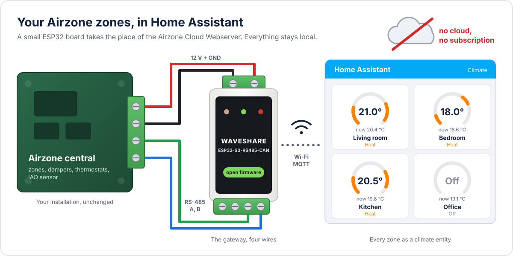
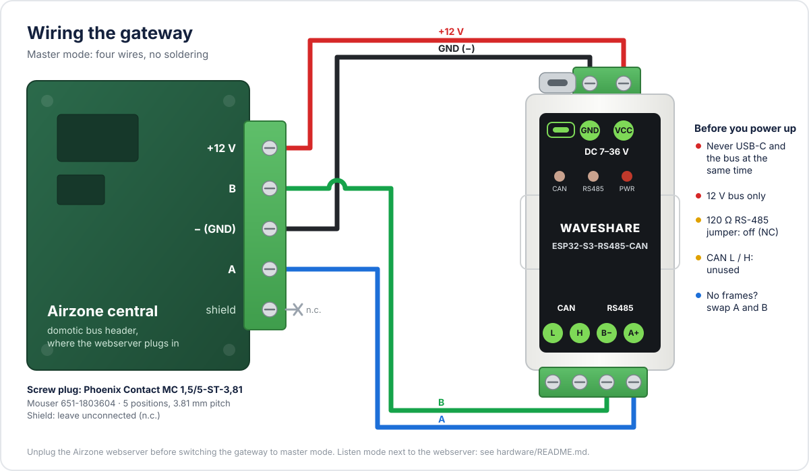

# Open Airzone Gateway

**Local, cloud-free control of Airzone HVAC zoning from Home Assistant.** A small ESP32 board takes the
place of the Airzone Cloud Webserver and puts every zone in Home Assistant, without the Airzone cloud.

[](https://github.com/letherman255/Open-Airzone-Gateway/actions/workflows/ci.yml)
[](https://github.com/letherman255/Open-Airzone-Gateway/releases/latest)
[](LICENSE)
[](hardware/LICENSE)



- **About €30-40 of hardware**: a Waveshare ESP32-S3 board and one screw plug.
- **No subscription, no account**, no internet connection needed.
- **Four wires**, no soldering, nothing to compile.
- **Every zone in Home Assistant**, found by itself: on/off, mode, setpoint, temperature, humidity, air quality.

[](https://letherman255.github.io/Open-Airzone-Gateway/)

> **Unofficial project, not affiliated with or endorsed by Airzone.** It writes to your heating and
> cooling installation and has been verified on one installation so far: read [Status](#status) and
> [Known issues](docs/known-issues.md).

## Getting started

### 1. Get the parts

| Part | Notes |
|---|---|
| **Waveshare ESP32-S3-RS485-CAN** | the gateway: powered by the bus (7-36 V input), isolated RS-485 |
| **Phoenix Contact MC 1,5/5-ST-3,81** screw plug (Mouser 651-1803604) | plugs onto the central's 5-pin bus header, where the webserver plugs in |
| **USB-C data cable** | for flashing only (some charge-only cables will not work) |
| Phoenix Contact IMC 1,5/5-ST-3,81 (Mouser 651-1857919) | optional: keeps the stock webserver plugged in, to try listen mode first |

About €30-40 for the board and the plug, depending on the shop. Other ESP32 boards work too, but need a
build from source ([hardware/README.md](hardware/README.md)).

### 2. Flash it from your browser

Plug the board into a computer with the USB-C cable, **not into the Airzone bus**. Open the
[web flasher](https://letherman255.github.io/Open-Airzone-Gateway/) in Chrome or Edge and click *Install firmware v…*.
Nothing to install on the computer.

### 3. Wire it

Unplug the board from USB first. **Never power it from USB and from the bus at the same time**, and never
apply more than 12 V. Four wires from the screw plug to the board's terminals:



Want to try it without risk? Start in **listen mode next to your webserver**: the gateway only listens to the
bus and never transmits, while the stock webserver keeps working. Listen-mode wiring:
[hardware/README.md](hardware/README.md).

### 4. Connect

1. On a phone, join the Wi-Fi `airzone-gw-XXXX`, then enter your Wi-Fi (2.4 GHz) and your MQTT broker.
2. Open `http://<gateway IP>` and **set the admin password right away**.
3. In Home Assistant, the gateway, the central and every zone appear by themselves.
4. To take control: unplug the stock webserver, then on the gateway page *Gateway → Bus mode → Switch to
   master mode*.

Going back is simple: unplug the gateway and plug the stock webserver in again. Installation settings live
in the central, not in the webserver. Full guide: [docs/install.md](docs/install.md).

**MQTT.** Home Assistant talks to the gateway through MQTT. If you don't have a broker yet, install the
[Mosquitto broker add-on](https://github.com/home-assistant/addons/blob/master/mosquitto/DOCS.md) and the
[MQTT integration](https://www.home-assistant.io/integrations/mqtt/). Nothing else to install in Home
Assistant: no custom integration, no HACS.

## Compatibility

| | Installation |
|---|---|
| **Verified** | Airzone Easyzone pack "Medium QAI Mitsubishi L, 6 outlets" (PP25MELBS01L6) with IAQ sensor, Blueface thermostats, Airzone Cloud Webserver AZX6WSC5GER, Mitsubishi Electric PEAD-M125JA2 ducted indoor unit with PUZ-ZM125VDA outdoor unit |
| **Expected to work** | other Airzone AZ6 centrals on the same domotic bus (per Airzone's public AZ6 Modbus integration manual) |
| **Unknown** | everything else |

Have a different installation? Please report yours, even in listen mode only: open a
[new installation issue](https://github.com/letherman255/Open-Airzone-Gateway/issues/new?template=new-installation.md).

## Why

In May 2026 Airzone announced the **Airzone Cloud "Plan Cloud"** subscription, from October 2026: after six
free months, **€48 per year per installation**. Without it, remote control is reduced to **viewing only**
(no remote on/off or setpoint), history is limited to the current day, and routines and scenarios are
subscription features. Airzone states that local control and basic features stay free.

For owners of the **Airzone Cloud Webserver** (for example AZX6WSC5GER) that promise does not help much:
this webserver does not offer Airzone's documented local API (its port 3000 is closed), so every app, voice assistant and Home
Assistant integration goes through the cloud. Airzone's local-API option is a different product, the
Webserver HUB (AZX6WSPHUB), bought separately.

Yet everything the cloud does with your installation ends up as a few frames on a two-wire bus in your
house. This project speaks that bus itself, locally.

## Features

- **Home Assistant over MQTT discovery**: one `climate` entity per zone, sensors (temperatures, humidity, air
  quality, errors), relay switches, everyday settings, gateway health. Works with any MQTT consumer.
- **Discovers the installation by itself**: centrals, zones and their names, IAQ sensor, outlets, relays.
- **Local installer page**: system, zone, outlet and IAQ sensor settings, live values, a change journal with
  undo, backup and restore. Dangerous settings need a typed confirmation.
- **Safe by construction**: a setting is writable only if its write was confirmed on a real bus, every
  write is read back, and the gateway refuses to become master if it hears another one.
- **Two modes**: *listen* (receive only, next to the stock webserver) and *master* (replaces it).
- **Documented local API**: HTTP JSON + WebSocket ([docs/api.md](docs/api.md)), a command-line client.
- **Maintenance**: Wi-Fi setup portal, firmware updates over Wi-Fi with automatic rollback, optional update
  check, admin password and API tokens. From 0.2.0 the gateway page can install a newer release in one
  click (admin only); it will be tested for real with 0.2.1, and the manual update stays the fallback.

Cloud features (schedules, scenes, users, voice assistants) are not reproduced: Home Assistant does them
better.

## How it works

```
 Airzone central(s) ──RS-485 bus── ESP32 gateway ──Wi-Fi── MQTT broker ── Home Assistant
 thermostats, dampers,  19200 8E1   Rust firmware            │
 IAQ sensor behind it   + 12 V      (ESP-IDF)                └── browser: installer page, API
```

The gateway polls the central like the stock webserver does (one cycle every ~2.3 s) and turns its registers
into typed values through a register catalogue. Commands become Modbus writes, reported as applied only once
the central reads back the new value. Details: [protocol](docs/protocol.md),
[register catalogue](docs/registers.md), [how the registers were found](docs/reverse-engineering.md),
[design](docs/design.md).

## Status

| | |
|---|---|
| Listen mode | runs on the author's installation since 2026-11-05 |
| Master mode | runs on the author's installation since 2026-11-06 (stock webserver unplugged): discovery, polling, Home Assistant control, every non-dangerous confirmed setting in both directions |
| Not verified yet | a 7-day unattended run, other installations, several centrals, zones 17-32, radiant stages, other indoor units, one-click updates |

## Documentation

| | |
|---|---|
| Users | [Install](docs/install.md) · [Hardware](hardware/README.md) · [Security](docs/security.md) · [Known issues](docs/known-issues.md) · [Changelog](CHANGELOG.md) |
| Integrators | [API](docs/api.md) · [OpenAPI](docs/openapi.yaml) · [Register catalogue](docs/registers.md) |
| Contributors | [Contributing](CONTRIBUTING.md) · [Development](docs/development.md) · [Bus protocol](docs/protocol.md) · [Reverse engineering notes](docs/reverse-engineering.md) · [Design](docs/design.md) |

## Contributing

Reports from other installations are the most useful contribution, then recordings, confirmed registers,
board support and PCBs. Read [CONTRIBUTING.md](CONTRIBUTING.md) first, in particular the rules for testing
a setting safely: some installer settings (alarm input, R32, filter counters, factory resets) can lock an
installation until it is power-cycled.

## Licence

Software: MIT ([LICENSE](LICENSE)). Hardware: CERN-OHL-P-2.0 ([hardware/LICENSE](hardware/LICENSE)).
Airzone is a trademark of its owner. This project is independent and contains no Airzone code, firmware or
documents; the bus was learned from observation and from Airzone's public Modbus integration manual.
