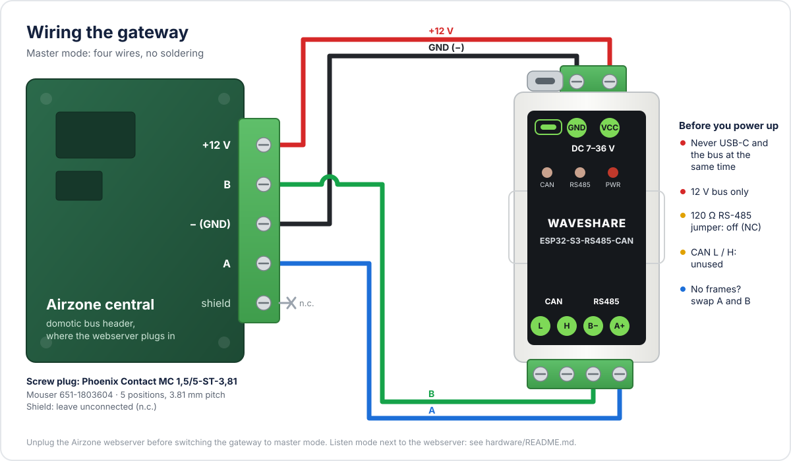

# Installing the gateway

This is the long form of the four steps in the [README](../README.md#getting-started). You need no
development tools: the firmware is flashed from the browser and set up from a phone.

## 1. Get the parts

| Part | Notes |
|---|---|
| Waveshare ESP32-S3-RS485-CAN | the reference board: 7-36 V input powered by the bus, isolated RS-485, BOOT button |
| Phoenix Contact MC 1,5/5-ST-3,81 screw plug (Mouser 651-1803604) | 5 positions, 3.81 mm pitch; plugs onto the central's domotic-bus header |
| USB-C data cable | for the first flash only. Some charge-only cables carry no data: if the computer sees nothing, try another cable |
| Stranded wire, 0.25-0.5 mm², 4 colours | |
| Phoenix Contact IMC 1,5/5-ST-3,81 (Mouser 651-1857919) | optional, for listen mode next to the stock webserver |

Budget: about €30-40 for the board and the plug. Other ESP32 / ESP32-S3 boards with an RS-485 module work,
but their pins are chosen at build time, so they need a build from source ([development.md](development.md),
[hardware/README.md](../hardware/README.md)).

## 2. Flash the firmware

**The board must not be connected to the Airzone bus while it is on USB.** Never power it from USB and from
the bus at the same time.

### From the browser (recommended)

1. Plug the board into a computer with the USB-C data cable.
2. Open the [web flasher](https://letherman255.github.io/Open-Airzone-Gateway/) in **Chrome or Edge** on a
   computer (Firefox, Safari and phones have no Web Serial).
3. Click *Install firmware*, choose the board's serial port, and confirm.
4. The flasher asks whether to **erase the device**:
   - *erase* gives a fresh board (recommended the first time, and when a board was used for something else);
   - *keep* keeps the gateway settings (Wi-Fi, MQTT, admin password) when you reinstall over an existing
     gateway. The new firmware always starts from its first slot either way.
5. Wait for the end of the flash (about a minute), then unplug the USB cable.

If the port does not appear: try another cable or USB port. If flashing does not start, hold the board's
BOOT button while plugging in the USB cable, then try again.

### By hand (fallback)

Each [release](https://github.com/letherman255/Open-Airzone-Gateway/releases) has a merged image
`airzone-gateway-<version>-full.bin` that goes at offset 0 (bootloader, partition table, cleared OTA data and
the application), and `SHA256SUMS` to check the downloads. With
[espflash](https://github.com/esp-rs/espflash) or esptool:

```sh
espflash write-bin --chip esp32s3 0x0 airzone-gateway-<version>-full.bin
# or
esptool.py --chip esp32s3 write_flash 0x0 airzone-gateway-<version>-full.bin
```

Building from source: [development.md](development.md).

## 3. Wire it to the bus

Unplug the USB cable first. The wiring, the connector pinout and the electrical rules are in
[hardware/README.md](../hardware/README.md):



- + (12 V) to **VCC**, − to **GND** (top terminals), A to **A+**, B to **B−** (bottom terminals), shield not
  connected.
- Keep the RS-485 termination jumper **off**.
- If A and B are swapped nothing is damaged, but no frame is received: swap them.

**Trying it first (listen mode).** You can keep the stock webserver: an IMC plug lets it stay stacked on the
same bus while the gateway listens. The gateway always starts in listen mode: it never transmits on the bus,
so it cannot disturb the installation. You can watch the values arrive, compare them with the Airzone app
and decide later.

## 4. Connect

1. **Set up the network.** Power the bus (or the central). On a phone, join the open Wi-Fi
   `airzone-gw-XXXX`; the setup page opens by itself (otherwise browse to `http://192.168.4.1`). Enter your
   2.4 GHz Wi-Fi and the MQTT broker URL (`mqtt://<broker>:1883`) with its user and password. Save: the
   gateway restarts on your network.
2. **Set the admin password right away** at `http://<gateway IP>` (the IP is shown by your router; the
   first password can be set by anyone who reaches the page before you). Without it the page is read only.
3. **Home Assistant.** With the MQTT integration configured, the gateway, the central, every zone (climate
   entity) and the IAQ sensor appear by themselves through MQTT discovery. No broker yet? Install the
   [Mosquitto broker add-on](https://github.com/home-assistant/addons/blob/master/mosquitto/DOCS.md) and
   the [MQTT integration](https://www.home-assistant.io/integrations/mqtt/).

### From listen to master

In listen mode Home Assistant shows the values but cannot change anything. To take control:

1. Unplug the stock webserver from the bus (there must be only one master).
2. On the gateway page: *Gateway → Bus mode → Switch to master mode*, and confirm.
3. The gateway checks that the bus is quiet before it starts polling. If it hears another master, it refuses
   and stays in listen mode.

## Going back to the stock webserver

Switch the gateway back to listen mode (or simply unplug it), then plug the stock Airzone webserver in again.
Installation settings are stored in the central and the thermostats, not in the webserver or the gateway, so
nothing is lost either way.

## Resetting the network settings

Hold the **BOOT** button for 5 seconds: the gateway forgets its Wi-Fi and MQTT settings and restarts in setup
mode (`airzone-gw-XXXX`). Installation settings are not affected. The setup Wi-Fi also comes back by itself
after 10 minutes without a Wi-Fi connection.

## Updates

**Update check (optional, off by default).** On the gateway page, *Gateway → Network*, tick *Check for
updates from the official releases*. The gateway then reads the release manifest on
`letherman255.github.io` once a day and shows a newer version on the page and in the Home Assistant update
entity. It never installs anything by itself. Untick it to stop the check; the field below it accepts a
custom manifest URL.

**One-click install** from the gateway page is coming with the next release.

**Manual update** (admin password or API token needed): download `airzone-gateway-<version>.bin` (the
application image, not the `-full` one) from the
[releases](https://github.com/letherman255/Open-Airzone-Gateway/releases), then send it with
`python -I tools/gwctl.py --host <gateway IP> --token-file <file> ota airzone-gateway-<version>.bin`, or with
`POST /api/v1/ota` followed by `POST /api/v1/ota/confirm` ([api.md](api.md)).

Every update keeps your settings and is protected by a rollback: the new firmware must be confirmed once it
is back on Wi-Fi (`gwctl ota` does it for you); if it is not confirmed within 180 s, the gateway restarts on
the previous version. Only one firmware write runs at a time.

You can also reflash from the browser at any time (choose *keep* to keep your settings).
